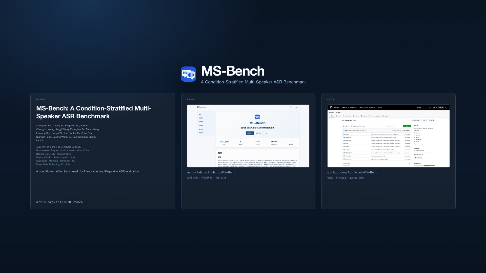

<h2>MS-Bench: A Condition-Stratified Multi-Speaker ASR Benchmark</h2>

**MS-Bench** is a condition-stratified benchmark for fine-grained multi-speaker automatic speech recognition (MSASR) evaluation. It integrates public and internal benchmarks across diverse scenarios, languages, and recording devices, with recordings stratified by **speaker number, overlap ratio, speaker similarity, speaker turn interval, and acoustic quality**.

The leaderboard, detailed evaluation results, and Condition Explorer are available on the [demo page](https://aslp-lab.github.io/MS-Bench/).

## Demo Video

  

**[▶ Watch the full demo](https://aslp-lab.github.io/MS-Bench/assets/ms-bench-demo.mp4)** · [Download MP4](assets/ms-bench-demo.mp4) · 1080p · 5 min 38 s

## Benchmark Overview

MS-Bench contains **32.72 hours** of audio. Individual recordings range from **1.38 to 159.07 minutes**, with a median duration of **16.50 minutes**. It covers **five condition dimensions**, **2–14 speakers** per recording, and a **duration-weighted average overlap ratio of 21.87%**. We evaluate **seven systems** on the benchmark.

| Total duration | Condition dimensions | Speakers | Duration-weighted overlap | Evaluated systems |
|:--:|:--:|:--:|:--:|:--:|
| **32.72 h** | **5** | **2–14** | **21.87%** | **7** |

The benchmark spans **meetings**; **spontaneous conversations**, including dinner-party conversations, in-vehicle exchanges, and other everyday dialogue; **media content**, including podcasts, films and television, and live streams; and **classroom interactions**, including teaching and teacher–student dialogue. Audio is captured using mobile phones, smart glasses, in-vehicle microphones, and a variety of microphone arrays. The recordings primarily contain Chinese and English speech, with additional samples in Portuguese, Japanese, Italian, Thai, and Spanish.

Each recording is stratified along **speaker number, overlap ratio, speaker similarity, speaker turn interval, and acoustic quality**, enabling systematic evaluation across diverse interaction and acoustic conditions.

## Benchmark Construction

  

Recordings are collected from public and internal benchmarks and characterized along the five condition dimensions. A condition space and candidate pool are then constructed, and the final subset is selected for condition coverage, co-occurring challenges, condition-profile diversity, and source diversity. Audio integrity, transcripts, speaker annotations, and timestamps are manually checked.

## Condition Space

Each tier shows its condition range, recording count, and percentage of the 99 recordings.

| Dimension | Tier 0 | Tier 1 | Tier 2 | Tier 3 | Tier 4 |
|:--|:--:|:--:|:--:|:--:|:--:|
| **P: Speaker number** Number of reference speakers | **P0** 2 speakers 27 / 27.3% | **P1** 3-4 speakers 29 / 29.3% | **P2** 5-8 speakers 33 / 33.3% | **P3** ≥9 speakers 10 / 10.1% | - |
| **O: Overlap ratio** Recording-level overlap | **O0** 0 23 / 23.2% | **O1** (0, 0.10) 22 / 22.2% | **O2** [0.10, 0.20) 10 / 10.1% | **O3** [0.20, 0.40) 26 / 26.3% | **O4** [0.40, 1.00] 18 / 18.2% |
| **S: Speaker similarity** Maximum pairwise cosine similarity | **S0** [0.00, 0.32) 9 / 9.1% | **S1** [0.32, 0.49) 12 / 12.1% | **S2** [0.49, 0.65) 31 / 31.3% | **S3** [0.65, 1.00] 47 / 47.5% | - |
| **T: Speaker turn interval** 25th percentile; higher tiers mean shorter intervals | **T0** ≥0.45 s 10 / 10.1% | **T1** [0.15, 0.45) s 14 / 14.1% | **T2** [0.06, 0.15) s 42 / 42.4% | **T3** [0.00, 0.06) s 33 / 33.3% | - |
| **N: Acoustic quality** d_N; higher tiers mean poorer quality | **N0** [0.00, 0.27) 7 / 7.1% | **N1** [0.27, 0.51) 5 / 5.1% | **N2** [0.51, 0.74) 25 / 25.3% | **N3** [0.74, 1.00] 62 / 62.6% | - |

View the interactive condition distributions on the [demo page](https://aslp-lab.github.io/MS-Bench/demo.html#overview).

Acoustic quality is represented by `d_N = 1 - (p_D + p_N) / 2`, where `p_D` and `p_N` are the percentile ranks of DNSMOS P.835 and NISQA scores. Larger values indicate poorer acoustic quality.

## Overall Performance

Results from the [paper](https://arxiv.org/abs/2610.25824). All error rates are percentages (↓ lower is better); **bold** indicates the best score.

| System | DER ↓ | cpWER ↓ | tcpWER ↓ | WER ↓ | Excluded units | Soft-degradation units |
|:--|--:|--:|--:|--:|--:|--:|
| MOSS-Transcribe-Diarize-Pro | **10.96** | **21.95** | **22.81** | **22.49** | 15 | 2 |
| MOSS-Transcribe-Diarize | 12.74 | 24.94 | 26.22 | 25.02 | 0 | 2 |
| Qwen3.8-Omni-Flash | 17.97 | 29.43 | 32.59 | 27.86 | 5 | 2 |
| VibeVoice-ASR | 20.19 | 43.41 | 44.76 | 33.11 | 10 | 12 |
| pyannote+Qwen3-ASR | 17.35 | 43.25 | 46.54 | 34.96 | 0 | 1 |
| Doubao-ASR 2.0 | 39.52 | 55.37 | 62.07 | 38.20 | 4 | 26 |
| SoulX-Transcriber (5-min segments) | 19.42 | 49.16 | 52.60 | 39.96 | 8 | 30 |

DER evaluates diarization (0.5-second collar); cpWER evaluates speaker-attributed transcription; tcpWER adds temporal constraints (5-second collar); WER ignores speaker labels. Excluded units are omitted from scoring, while soft-degradation units remain included; scores therefore reflect different valid-output coverage.

**MOSS-Transcribe-Diarize-Pro achieves the lowest error on all four metrics**, followed by MOSS-Transcribe-Diarize. MOSS-Transcribe-Diarize and the cascaded system have no excluded units, highlighting the importance of output robustness alongside accuracy. Similar DERs can still mask substantial differences in speaker-attributed transcription, as seen for Qwen3.8-Omni-Flash and pyannote+Qwen3-ASR.

## Condition-wise Analysis

Results from Table 2 of the paper. **Δ** denotes an error-rate difference in percentage points (pp); **ρ** denotes a Spearman correlation; **\*** marks statistical significance.

### Speaker Interaction and Similarity

| System | Overlap Δlex (pp) | Overlap Δattr (pp) | Similarity ρsim | Turn-boundary Δattr (pp) | Speaker-count ρattr given D, O |
|:--|--:|--:|--:|--:|--:|
| MOSS-Transcribe-Diarize-Pro | +27.3* | +10.6* | +0.311* | +2.49* | +0.403* |
| MOSS-Transcribe-Diarize | +27.3* | +10.9* | +0.312* | +2.48* | +0.350* |
| Qwen3.8-Omni-Flash | +28.7* | +10.5* | +0.323* | +2.74* | +0.257 |
| VibeVoice-ASR | +34.3* | +4.2* | +0.297* | +3.07* | +0.054 |
| pyannote+Qwen3-ASR | +38.6* | +19.1* | +0.248* | +3.43* | +0.438* |
| Doubao-ASR 2.0 | +27.2* | +6.3* | +0.268* | +4.17* | +0.281* |
| SoulX-Transcriber (5-min segments) | +35.2* | +8.7* | +0.319* | +1.51* | — |

### Acoustic Quality

| System | ρ(d_N, E_lex) | ρ(d_N, E_attr) | ρ(d_N, R_time) |
|:--|--:|--:|--:|
| MOSS-Transcribe-Diarize-Pro | +0.392* | −0.060 | −0.350* |
| MOSS-Transcribe-Diarize | +0.480* | −0.121 | −0.405* |
| Qwen3.8-Omni-Flash | +0.364* | −0.063 | −0.335* |
| VibeVoice-ASR | +0.569* | +0.081 | −0.436* |
| pyannote+Qwen3-ASR | +0.392* | +0.030 | −0.437* |
| Doubao-ASR 2.0 | +0.304* | −0.057 | −0.145 |
| SoulX-Transcriber (5-min segments) | +0.181* | −0.174* | −0.246* |

`lex` denotes lexical recognition error; `attr` denotes speaker-attribution error; `R_time` is predicted/reference speech duration. Speaker-count correlations control for dataset (`D`) and overlap (`O`), excluding the ≥9-speaker tier and SoulX.

- **Overlap** degrades both lexical recognition and speaker attribution across all seven systems.
- **Speaker similarity** increases speaker confusion even without overlapping speech.
- **Speaker turn boundaries** mainly increase attribution errors, with no significant lexical or segmentation penalty.
- **Acoustic degradation** mainly affects lexical recognition and is associated with shorter predicted speech timelines in six of seven systems.
- **Higher speaker counts** are associated with greater attribution difficulty after controlling for dataset and overlap, significantly in four of six systems.

Explore the results interactively on the [project page](https://aslp-lab.github.io/MS-Bench/).
